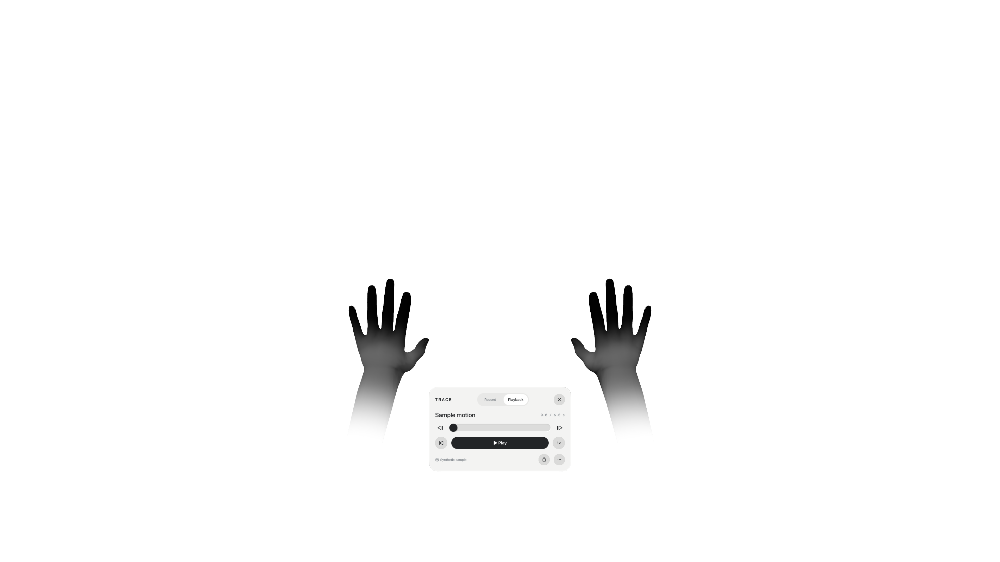

# TRACE — The Motion Chamber

A native visionOS app for Apple Vision Pro that records hand movements and replays them as interactive 3D motion sculptures. Built with SwiftUI, RealityKit, and ARKit.



TRACE is an experimental prototype. Simulator and core regressions pass; physical-device installation and opening have been confirmed. Tracking under occlusion, comfort, latency, and headset frame rate still need physical validation. It is not a robotics controller, medical device, or calibrated motion-capture system.

## Features

- An immersive white studio with generic anatomical hands, soft gray palm shading, black fingertips, and smooth wrist fades.
- Left, right, or both-hand capture: a three-second countdown and up to ten seconds of motion.
- Playback with pause, replay, scrubbing, one-second steps, and 0.5×/1× speed.
- Saved studies stored locally, restored after relaunch, and individually deletable.
- A stable stage reference and a movable replay sculpture.
- Experimental fingertip distance feedback for following a recorded study.
- Explicitly labeled synthetic simulator samples; no wearer recordings are included.
- Native accessibility labels and Reduce Motion support.

## Requirements and setup

The current project was verified with Xcode 27.1 and the visionOS 27.0 SDK. Its deployment target is visionOS 2.0; compatibility with every earlier runtime has not been separately tested. Hand tracking requires a physical Apple Vision Pro.

1. Open `TRACE.xcodeproj` and select the **TRACE** scheme.
2. For a simulator preview, select a visionOS simulator and run. Use **More → Load sample** to explore synthetic motion.
3. For a physical headset, copy `Configuration/LocalSigning.xcconfig.example` to `Configuration/LocalSigning.xcconfig`. Enter your own Apple development team and unique app/test bundle identifiers there. The public defaults use `com.example.trace`; the local file is ignored by Git.
4. Pair the headset with Xcode, enable Developer Mode on the headset, select it as the run destination, and run. Complete any Apple Account, device trust, or keychain prompts locally.
5. Open **Enter studio** and allow Hand Tracking. Use the console's exit control to return to the launch window.

There are no third-party runtime packages, API keys, backend services, or paid assets to configure. A signed app bundle and provisioning profile are deliberately excluded from this source distribution. Build your own signed app with your own team.

## Run checks

From the project directory:

```sh
swift test
xcodebuild -project TRACE.xcodeproj -scheme TRACE \
  -destination 'platform=visionOS Simulator,name=Apple Vision Pro,OS=27.0' \
  -parallel-testing-enabled NO CODE_SIGNING_ALLOWED=NO test
```

Choose an available simulator in Xcode if that destination differs on your Mac. Physical hand input is unavailable in Simulator.

For visual previews, simulator-only launch arguments include `--preview-chamber`, `--preview-capture`, `--preview-hand-detail`, and `--preview-flexed`. These do not automatically enter immersion on hardware.

## Architecture and data

| Location | Responsibility |
| --- | --- |
| `TRACE/StudioModel.swift` | Recording, countdown, playback, library state, and render clock |
| `TRACE/Tracking/HandTrackingService.swift` | ARKit permissions, provider lifecycle, joint snapshots, and stable reference |
| `TRACE/Scene/ChamberScene.swift` | Studio, hand surfaces, gradients, trails, and replay handle |
| `TRACE/Core/` | Motion schema, interpolation, capture limits, geometry, and synthetic samples |
| `TRACE/Storage/TakeStore.swift` | Atomic local JSON persistence and deletion |
| `TRACE/UI/` | Welcome screen, console, and immersive attachments |
| `TRACE/HandAssets/` | Generic CC0 model buffers; no captured wearer data |
| `Tests/`, `TRACEUITests/` | Core regression and simulator flow tests |

Joint transforms are stored in stage-relative meters. TRACE freezes a yaw-only reference from the initial device pose; head movement and replay dragging do not rebase recorded motion. Playback interpolates translations and quaternions, preserves confidence flags, and hides whole-hand tracking loss and long gaps.

The display follows a RealityKit rendering-phase system and can use ARKit-predicted anchors. Recording uses unpredicted snapshots, actual timestamps, and a maximum cadence of 60 samples per second. Inferred joints retain their low-confidence flags. Brief display continuity is never written back as measured motion. Actual headset frame rate and latency have not been measured.

Studies are saved in the app container. TRACE has no networking client, analytics, camera-frame capture, audio recording, or cloud-sync implementation. See [PRIVACY.md](PRIVACY.md) for the exact stored fields, retention, deletion, and operating-system backup limitations.

## Validation and limitations

The latest results are summarized in [Verification.json](Documentation/Verification.json). Simulator screenshots use synthetic data. Raw build/device logs are excluded because they may contain personal paths, signing identities, and device identifiers.

The prototype cannot recover a hand fully hidden from headset sensors and does not track another person's hands. Closed fists and contact poses have synthetic geometry regressions, but require additional wearer testing. Native timeline dragging, replay movement, and distance feedback also require physical input validation. There is no scientific accuracy score, robotics export/control, cloud sharing, video export, or multi-user mode.

## Before publishing changes

```sh
git config --local core.hooksPath .githooks
python3 Scripts/audit_public.py --staged
```

Use a public account alias and a GitHub-provided noreply address for your local commit identity. Review `git diff --cached` and `git status --short` before pushing. The hook inspects the exact staged bytes. For a full local history check, run `python3 Scripts/audit_public.py --history` and Gitleaks with redaction enabled.

An inactive GitHub Actions template is included at `Documentation/Tools/privacy-workflow.yml`. It runs the publication guard and a checksum-pinned Gitleaks scan with read-only repository permissions. The publishing connection could not create active workflows, so automated GitHub checks are not enabled. To enable them later, place the template at `.github/workflows/privacy.yml` using a connection with workflow-write permission.

Do not commit `LocalSigning.xcconfig`, credentials, signed builds, provisioning profiles, device logs, recordings, or personal screenshots. A `.gitignore` does not remove already tracked files or old commits. Export only tracked files, for example using `git archive`; do not zip the entire development folder, which can contain ignored private settings. See [the publication audit](Documentation/SecurityAudit.md) for the reviewed snapshot and outstanding remote-history item.

## Third-party assets

The generic hand models are CC0 assets by **Miodrag Sejic / DigitalN8m4r3** from Godot XR Tools. The exact source revision, original glTF files, license, modifications, and offline conversion script are included under `Documentation/ThirdParty/` and `Documentation/Tools/`. This credit identifies the asset creator, not the app's developer. No skin-color or skin-normal textures are bundled in the app.

