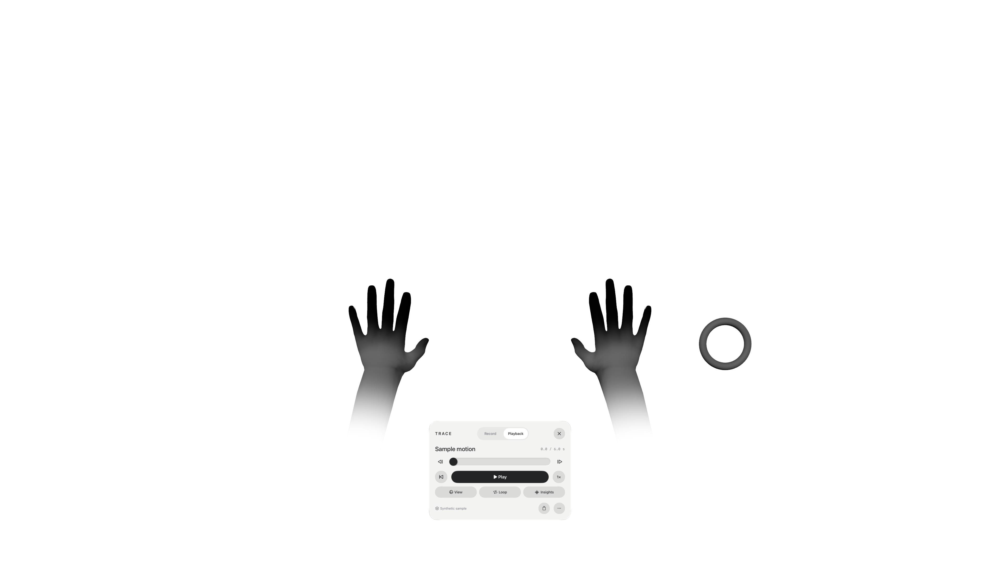
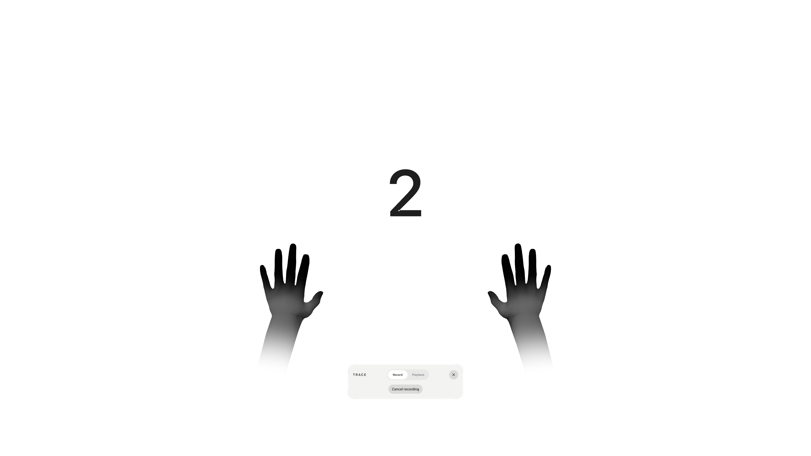
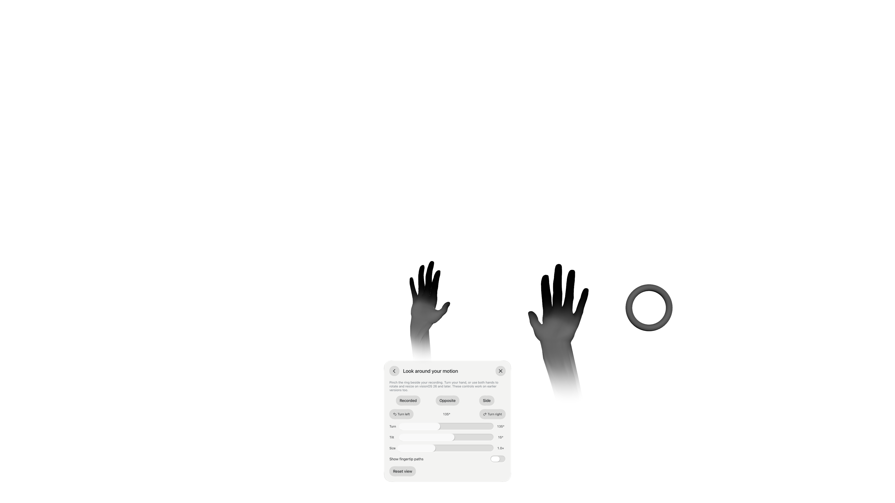
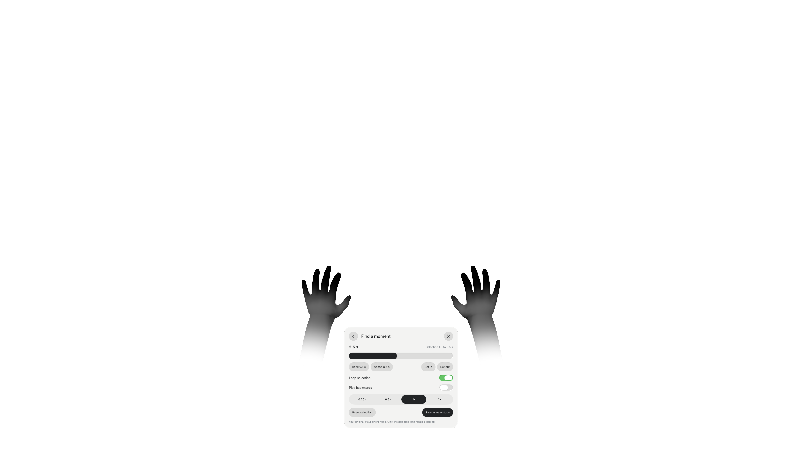
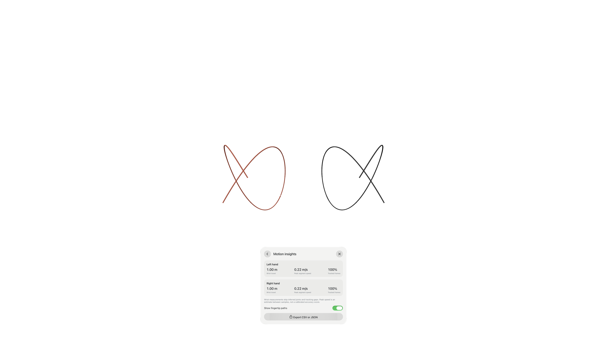
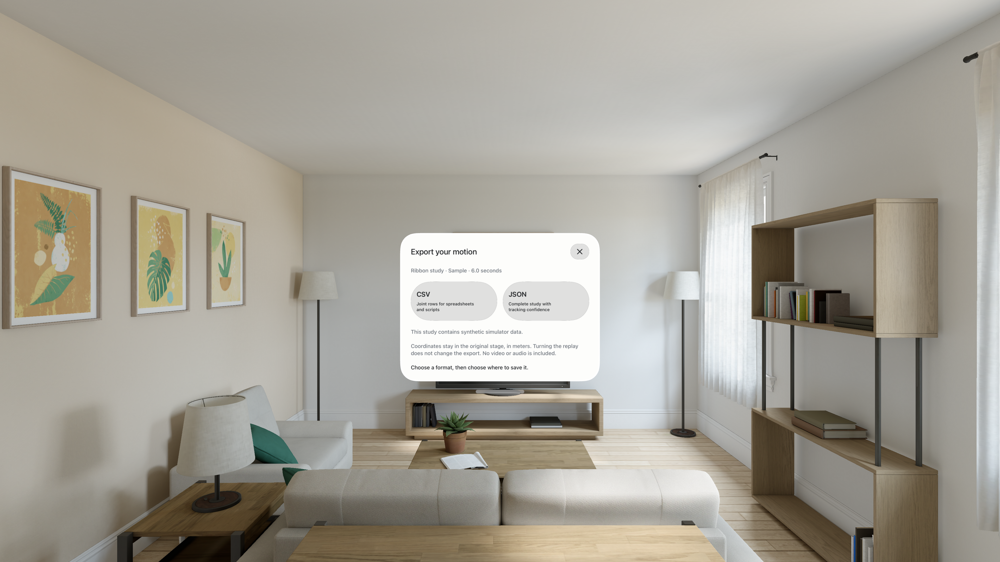

# TRACE

Record a hand movement. Turn it around, slow it down, and find the part worth keeping.

TRACE is a native Apple Vision Pro motion studio built with SwiftUI, RealityKit, and ARKit. Version 0.2 adds a clearer countdown, 360-degree inspection, loop editing, fingertip paths, motion insights, and local file export.



## A closer look

| A countdown you can read | A view from every side |
| :---: | :---: |
|  |  |
| One large 3D digit, with no circle or clipped captions. | Turn, tilt, resize, or jump to another side. |

| Keep a useful moment | See how the hand moved |
| :---: | :---: |
|  |  |
| Set in and out points, then save a separate study. | Inspect complete paths and measured wrist movement. |

These are screenshots of the running visionOS simulator. The hands and studies shown here are synthetic fixtures, not recordings of a person. Open an image to see the full resolution.

## Use the studio

1. Enter the studio and allow Hand Tracking on Vision Pro. Choose left, right, or both hands.
2. Press **Record motion**. Three digits count down before a recording of up to ten seconds.
3. In **Playback**, scrub, pause, or choose a slower speed. **View**, **Loop**, and **Insights** keep the review tools close without putting every setting on the main console.
4. Save a selection or export a study when you are ready to use it elsewhere.

### Look around a recording

On visionOS 26 and later, pinch the ring beside the recording. Move it with one hand, turn your hand to rotate it, or use both hands to rotate and resize. The recording stays where you release it.

The **View** panel also gives you a full-turn control, tilt, size, recorded/opposite/side presets, quarter-turn buttons, and reset. These controls remain available on earlier supported visionOS versions. The pivot follows the recording's bounds, so turning it does not swing it around the floor origin. Live hands and saved coordinates stay separate from the display transform.

### Work on a short section

In **Loop**, scrub to a moment and choose **Set in** or **Set out**. Repeat the selection, play backwards, or use 0.25×, 0.5×, 1×, or 2× speed. **Save as new study** creates a separate take with rebased timestamps and preserves the original.

### Understand the motion

**Show fingertip paths** draws the full index-finger trajectory for each hand. The path stays visible when paused and turns with the recording. Tracking gaps and inferred points stay disconnected.

**Insights** shows wrist travel, peak speed between samples, and the percentage of frames with a measured wrist. Inferred joints and gaps over 150 ms are excluded. Speed can be affected by tracking noise; the numbers are estimates, not a calibrated quality score.

## Take the data with you



Choose **Export CSV or JSON** in Insights, or **Export study** in More. TRACE returns to its main window and presents the system file picker after you choose a format.

- **CSV** contains one row per supplied joint, with source, stage coordinate system, time in seconds, hand identity, tracking flags, position in meters, and quaternion components in xyzw order. Missing hands get explicit rows with empty transforms.
- **JSON** preserves the complete study schema, including its creation date, generated ID, hand selection, frames, and confidence flags.

Turning, moving, or enlarging the replay does not change exported coordinates. To export only a section, save that selection as a new study first. See [the export format](Documentation/ExportFormat.md) for field definitions and examples.

## Where the data lives

Studies stay in the app's local container until deleted. TRACE has no networking client, account, analytics SDK, camera-frame capture, audio recording, or automatic upload. Export is a deliberate action; the system lets you choose a local or cloud-backed destination. Operating-system backup policies may also apply. [Privacy details](PRIVACY.md).

The hand models are generic CC0 assets, not scans of the wearer. Simulator samples are labeled synthetic. No wearer recordings, signed app bundles, provisioning profiles, or raw device logs are included in this repository.

## Build it

The update was built with Xcode 27.1 and the visionOS 27.0 SDK. The deployment target remains visionOS 2.0. Native object manipulation requires visionOS 26 or later; view controls provide inspection on earlier versions.

1. Open `TRACE.xcodeproj` and choose the **TRACE** scheme.
2. Select an available visionOS simulator. In the studio's More menu, load a synthetic sample or enable synthetic sample input.
3. For a headset, copy `Configuration/LocalSigning.xcconfig.example` to `Configuration/LocalSigning.xcconfig` and enter your own team and unique bundle identifiers. The local file is ignored by Git.
4. Pair Vision Pro with Xcode, enable Developer Mode, choose the headset, and run.

No API keys or third-party runtime packages are needed.

```sh
swift test
xcodebuild -project TRACE.xcodeproj -scheme TRACE \
  -destination 'platform=visionOS Simulator,name=Apple Vision Pro,OS=27.0' \
  -parallel-testing-enabled NO CODE_SIGNING_ALLOWED=NO test
```

Choose an available simulator if that destination differs on your Mac. [Verification details](Documentation/Verification.json) separate simulator evidence from physical-headset checks. Real tracking, native ring gestures, comfort, latency, and sustained headset frame rate require a device retest.

## Project notes

The recording reference stays fixed when the wearer moves their head. Joint transforms are stage-relative; replay inspection changes a separate presentation hierarchy. Capture uses unpredicted timestamps at no more than 60 samples per second. Display follows RealityKit's rendering update and can use predicted ARKit poses. Inferred transforms retain their original confidence flags.

| Location | What it does |
| --- | --- |
| `TRACE/StudioModel.swift` | Recording, playback, loop state, and local library |
| `TRACE/Scene/ChamberScene.swift` | Countdown meshes, anatomical hands, paths, and inspection pivot |
| `TRACE/Core/StudyTools.swift` | Loop timing, copy trimming, measurements, paths, and serialization |
| `TRACE/UI/` | Console, review tools, welcome screen, and file export |
| `TRACE/Tracking/`, `TRACE/Storage/` | ARKit lifecycle and local persistence |
| `Tests/`, `TRACEUITests/` | Core regressions and simulator workflows |

[Research and next experiments](Documentation/Research.md) explains the choices and sketches comparison, pose bookmarks, dataset labeling, animation import, and offline robotics retargeting. TRACE's export is human motion data. It does not control a robot or claim compatibility with a robot-training dataset.

## Public-source checks

Enable the local privacy hook and inspect the staged files before pushing:

```sh
git config --local core.hooksPath .githooks
python3 Scripts/audit_public.py --staged
python3 Scripts/audit_public.py --history
```

Use a public alias and GitHub noreply email for commits. Keep personal signing, captures, logs, credentials, and compiled builds out of Git. Export tracked source with `git archive` rather than zipping a development folder that may contain ignored private settings.

The GitHub Actions privacy workflow is an inactive template at `Documentation/Tools/privacy-workflow.yml`; the publishing connection does not have workflow-write permission. Local publication and credential scans are run before release. [Publication audit](Documentation/SecurityAudit.md).

## Hand assets

The generic anatomical models are CC0 assets by Miodrag Sejic / DigitalN8m4r3 from Godot XR Tools. Original glTF files, the source revision, license, modifications, and an offline converter are in `Documentation/ThirdParty/` and `Documentation/Tools/`. No skin-color or skin-normal textures are bundled in the app.
